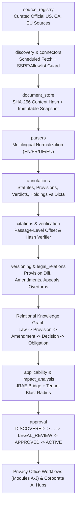

# KIBO Privacy OS — Enterprise Hardening v2 Architecture (`core/regulatory_intelligence`)

## 1. Architectural Overview

KIBO Privacy OS retains its modular monolith production architecture (`kibo-is/agent_gateway.py` + `kibo-is/core/*`) and extends it with a native, source-grounded **Continuous Regulatory Discovery, Legal Annotation, Citation Verification, and Temporal Knowledge Graph Engine** under `kibo-is/core/regulatory_intelligence/`.

---

## 2. Module Boundaries (`kibo-is/core/regulatory_intelligence/`)

| Subpackage | Responsibility |
|---|---|
| `source_registry/` | Curated, machine-readable registry of official US (Federal Register, eCFR, GovInfo, FTC, HHS OCR, 50 States + DC + territories), Canadian (Justice Canada XML, OPC, CanLII/Courts, 10 Provinces + 3 Territories), and EU (EUR-Lex, Cellar, EDPB, EDPS, CJEU, 27 Member State Gazettes & DPAs + 17 German Länder DPAs) sources with licensing, rate-limit, and health metadata. |
| `connectors/` | Compliant HTTP/XML/RSS/Atom/HTML/JSON connectors guarded by URL domain allowlists, SSRF blocks (no RFC1918/loopback/metadata IPs), size limits, timeouts, and prompt-injection sanitization. Returns `SOURCE_UNAVAILABLE` on outage—never fabricates fallback content. |
| `discovery/` | Configurable scheduled discovery runner (`6h` federal/EU feeds, `24h` state/provincial/decisions, `weekly` reconciliation, controlled backfill) with incremental checkpoints, SHA-256 deduplication, and idempotent restart recovery. |
| `document_store/` | Canonical versioned document store (`CanonicalLegalDocument`) persisting raw & normalized SHA-256 hashes, immutable snapshots, ELI/CELEX/neutral citations, language/translation attribution, and quarantine state for unverifiable legacy records. |
| `parsers/` | Multilingual structural legal parsers (English, French, German, plus EU member-state metadata) splitting statutes into articles/sections/paragraphs with exact character offsets (`text_start_offset`, `text_end_offset`) and decisions into facts, issues, reasoning, holdings, dicta, and orders. |
| `annotations/` | Source-grounded `LegalPassageAnnotation` and `DecisionVerdictAnnotation` extractors. Every annotation resolves to an exact `document_id`, `document_version`, character offset range, and `exact_source_excerpt`. |
| `citations/` | Deterministic passage-level Citation Verifier (`CitationVerificationService`). Rejects fabricated cases, nonexistent statutory sections, mismatched excerpts, and superseded versions (`UNVERIFIED` / `REJECTED`). |
| `entity_resolution/` | Canonicalizes regulator names, courts/tribunals, statutory instruments, and jurisdiction codes across languages and citation styles. |
| `legal_relations/` | Extends `ontology_store.py` with relational tables (`kg_laws`, `kg_provisions`, `kg_amendments`, `kg_decisions`, `kg_obligations`, `kg_edges`) supporting temporal queries (`as_of_date`) and precedent chains (`interprets`, `amends`, `overturns`, `appealedTo`). |
| `versioning/` | Structural provision-level diff engine distinguishing substantive legal changes (deadlines, thresholds, penalties, scope) from editorial/formatting changes, preserving full historical text. |
| `verification/` | Independent verification gate checking source authenticity, hash integrity, citation alignment, and prompt-injection neutrality before technical validation. |
| `applicability/` | Bridges discovered instruments and decisions to `core/jrae/engine.py`. |
| `impact_analysis/` | Computes tenant-isolated organizational blast radius across establishments, RoPA activities, assessments (`PIA`/`DPIA`/`TRA`/`TIA`/`AIIA`), controls, deadlines, and vendors. |
| `approval/` | Enforces the mandatory state machine: `DISCOVERED -> RETRIEVED -> VERIFIED_SOURCE -> ANNOTATED -> TECHNICALLY_VALIDATED -> LEGAL_REVIEW -> APPROVED -> ACTIVE` (plus `REJECTED`, `SUPERSEDED`, `SUSPENDED`, `REQUIRES_LEGAL_REVIEW`) with dual/role-verified human `LEGAL`/`CPO` sign-off. |
| `monitoring/` | Operational telemetry and metrics aggregator covering Source Coverage, Discovery, Annotation, Regulatory Coverage, Operational Impact, and Agent Performance. |
| `evaluation/` | Benchmark harness for local DGX Spark models and adversarial hallucination/citation/injection test suites (`RD-01` through `RD-18`). |
| `api/` | FastAPI router mounted at `/api/v1/regulatory-intelligence/*` with strict authentication and tenant isolation. |
