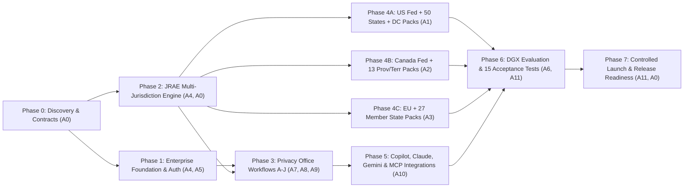

# KIBO Privacy OS — Phase 0: Master Execution Plan

**Date:** 2026-10-25  
**Platform:** KIBO Privacy OS (`https://kibo.is`)  
**Role:** Principal Architect & Autonomous Orchestrator (A0)

---

## 1. Execution Strategy

Execution proceeds in strict dependency order across 8 phases, leveraging independent Git branches/worktrees and explicit file ownership across our 12-agent engineering team (Antigravity A0/A7/A8/A9/A10/A11, Claude Code A1/A2/A3 on laptop, Codex CLI A4/A5 on laptop, and DGX Spark `dgx` for A6).

---

## 2. Phase-by-Phase Roadmap & Dependency Graph

---

## 3. Detailed Work Packages

### Phase 0: Repository Discovery & Canonical Contracts (Completed by A0)
- Audit repository, fix Git tracking against `origin/main`, verify local + DGX Spark runtimes.
- Establish canonical `docs/transformation/*` deliverables and `CanonicalRegulation` / `JRAE` API contracts.

### Phase 1: Enterprise Foundation, Database & Multi-Tenancy (A4 & A5)
- **A4 (Codex — Backend & DB)**:
  - Eliminate duplicate `Vendor` SQLAlchemy class collision between `core/models/assets.py` and `core/modules/vendor_risk/models.py`.
  - Upgrade `agent_gateway.py` and `core/database.py` to support PostgreSQL (`DATABASE_URL`) and thread-safe SQLite testing.
  - Ensure all existing unit tests in `kibo-is/tests/` pass (`test_models.py`, `test_dsar.py`, `test_vendor_risk.py`, `test_audit_logging.py`, `test_event_driven.py`, `test_repositories.py`, `test_services.py`, `test_multitenancy.py`).
- **A5 (Codex — Identity, Auth, Multi-Tenancy & Security)**:
  - Implement OIDC/SAML/JWT authentication and RBAC/ABAC policy engine (`core/security/auth.py`, `core/security/rbac.py`).
  - Enforce strict tenant isolation across REST APIs, background tasks, RAG queries, and MCP endpoints so no tenant can ever read another tenant's records (Acceptance Test 11).

### Phase 2: Multi-Jurisdiction Engine — JRAE (A4 & A0)
- Build `kibo-is/core/jrae/`:
  - `schemas.py`: `CanonicalRegulation`, `OrganizationProfileInput`, `ProcessingActivityInput`, `ApplicabilityEvaluationRequest`, `ApplicabilityEvaluationResponse`, `ApplicableObligation`, `DeadlineCalculation`, `ConflictEscalation`.
  - `registry.py`: Global Jurisdiction Registry enumerating US Federal + 50 States + DC + territories, Canada Federal + 10 Provinces + 3 Territories, EU + 27 Member States, plus UK/EEA expansion markers.
  - `engine.py`: Multi-layered evaluation (establishment nexus, extraterritoriality, statutory thresholds, entity/data exemptions, preemption/substantial similarity, effective dates vs future obligations, competent authorities, conflict escalation).
  - `deadlines.py`: State/provincial/member-state deadline calculator for DSARs, extensions, appeals, and breach notifications (regulator, AG, individual).
  - `router.py`: `POST /api/v1/compliance/applicability/evaluate`, `GET /api/v1/compliance/jurisdictions`, `GET /api/v1/compliance/regulations`, `POST /api/v1/compliance/deadlines/calculate`, `POST /api/v1/compliance/regulatory-changes/simulate`.

### Phase 3: Complete Privacy Office Workflows A–J (A7, A8, A9)
- **A7 (Antigravity — Assessments, Rights/DSAR, Inventory/RoPA, Consent)**:
  - Module B: Jurisdiction-specific Assessments (`PIA`, `DPIA`, `TRA`, `TIA`, `LIA`, `AIIA`, `VendorAssessment`, `DataSharingAssessment`, `ChangeImpactAssessment`).
  - Module D: Multi-jurisdiction Privacy Rights (`access`, `correction`, `deletion`, `portability`, `withdrawal`, `objection`, `restriction`, `appeal`, `authorized_agent`) with nexus validation.
  - Module E & F: Data Inventory / RoPA, International Transfer validator, Consent & GPC/UOOM preference ledger.
- **A8 (Antigravity — Incident/Breach, Governance, Vendor, Risk/Controls, RegIntel, Assistant)**:
  - Module A: Privacy Office Administration (org profile, establishments, officers, calendar, policies, executive board reports).
  - Module C: Multi-jurisdiction Incident & Breach response (intake, harm assessment, independent regime detection, deadline calculator, deduplicated workflow actions, evidence timeline, human approval gates).
  - Module G, H, I, J: Vendor BAA/DPA/SCC management, Risk/Control obligation mapping, Regulatory Change blast-radius analyzer, and Governed Privacy Office Assistant.
- **A9 (Antigravity — React Enterprise Portal & Tenant Onboarding)**:
  - Upgrade `kibo-is/src/` to expose the full multi-jurisdictional Privacy Office OS experience, JRAE Interactive Evaluator, Multi-Jurisdiction Breach War Room, RoPA & Transfer Map, Legal Pack Coverage Matrix, and Corporate Hub Status.

### Phase 4: Geographic Legal Packs (A1, A2, A3)
- **A1 (Claude — US Federal & 50 States + DC)**:
  - `kibo-is/core/regulatory_packs/us_federal.py` (HIPAA, HITECH, GLBA, FTC Act Sec 5, COPPA, FERPA, FCRA, Privacy Act 1974, E-Gov PIA, NYDFS/Banking, CIRCIA).
  - `kibo-is/core/regulatory_packs/us_states.py` (All 50 US states + DC + territories: CA CCPA/CPRA/CMIA/CalPrivacy/Data Broker/ADMT, CO CPA, VA VCDPA, CT CTDPA, TX TDPSA/CUBI/TMRPA, WA MHMDA, IL BIPA, NY Shield/NYDFS, UT, OR, MT, DE, IA, NE, NH, NJ, TN, MN, MD, IN, KY, RI + all 50-state breach notification & sectoral rules).
- **A2 (Claude — Canada Federal, 10 Provinces & 3 Territories)**:
  - `kibo-is/core/regulatory_packs/canada.py` (Federal PIPEDA, Privacy Act, ATIA, CASL, OSFI B-13/B-10; QC Law 25 + Act Respecting Access; ON PHIPA, FIPPA, MFIPPA, CYFSA; AB PIPA, HIA, FOIP; BC PIPA, FOIPPA; MB FIPPA, PHIA; NB RTIPPA, PHIPAA; NL ATIPPA, PHIA; NS FOIPOP, PIIDPA, PHIA; PE FOIPP, HIA; SK FOIP, HIPA; NT ATIPP, HIA; NU ATIPP; YT ATIPP, HIA).
- **A3 (Claude — EU-Wide & All 27 Member States)**:
  - `kibo-is/core/regulatory_packs/eu.py` (GDPR, ePrivacy, EU AI Act, NIS2, DORA, EUDPR, Law Enforcement Directive, SCCs/DPF/BCRs + individual national regulatory packs for all 27 EU Member States: AT, BE, BG, HR, CY, CZ, DK, EE, FI, FR, DE [Federal BDSG + Länder], GR, HU, IE, IT, LV, LT, LU, MT, NL, PL, PT, RO, SK, SI, ES, SE).

### Phase 5: Corporate AI Hub Integrations (A10)
- Build `kibo-is/integrations/`:
  - `m365_copilot/`: Declarative Agent manifest, OpenAPI 3.1 spec, Adaptive Cards, Entra ID SSO handler.
  - `claude_mcp/`: Secure remote/stdio FastMCP server exposing Privacy Office tools (`evaluate_applicability`, `report_incident`, `initiate_assessment`, `lookup_vendor`, `search_policies`, `query_privacy_assistant`, `route_approval`) with tenant isolation and read-only default.
  - `gemini_enterprise/`: Vertex AI / Gemini Enterprise extension manifest & tool router.

### Phase 6 & 7: DGX Spark Evaluation, 15 Mandatory Acceptance Tests & Release Readiness (A6, A11, A0)
- **A6 (DGX Spark `dgx`)**: Run ontology consistency checks, legal RAG grounding benchmarks, and synthetic compliance evaluations against `qwen3.6:35b-a3b-q8_0` / `gemma4:26b` on the NVIDIA GB10 GPU.
- **A11 (DevOps & QA)**: Execute all 15 Mandatory Acceptance Tests (`kibo-is/tests/test_acceptance_15.py`), multi-tenant isolation tests, offline-LLM resilience tests, Docker/Postgres compose stack, and update all CSV/MD deliverables in `docs/transformation/`.
